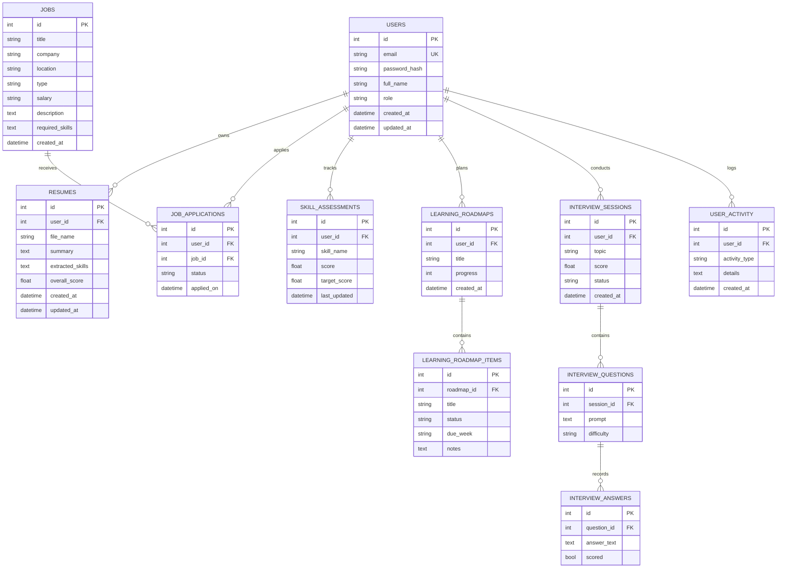

# Database Schema

This project uses a normalized relational model with SQLite for local development and a PostgreSQL-friendly schema for production.

## Notes
- File uploads are stored in `uploads/` rather than directly in the database.
- Ownership checks ensure a user only reads their own profiles and applications.
- The schema is intentionally PostgreSQL-compatible and easy to migrate with Alembic.
